# OOP2026

## [Week1 Homework](#Homework1)
## [Week2 Homework](#Homework5)
## [Week3 Homework](#Homework10)
## [Week4 Homework](#Homework13)
## [Week5 Homework](#Homework14)


<details>
<summary>Week1 Homework</summary>
	
### Homework1
```java
class triangle {
    public static void main(String[] args) {
        for (int i=0; i<10; i++){
            for(int j=0; j<=i; j++){
                System.out.print("#");
            }
            for(int j=i+1; j<10;j++){
                System.out.print(" ");
            }
            System.out.println();
        }
        System.out.println();

        for (int i=0; i<10; i++){
            for(int j=i; j<10; j++){
                System.out.print("#");
            }
            for(int j=0; j<=i-1; j++){
                System.out.print(" ");
            }
            System.out.println();
        }
        System.out.println();

        for (int i=0; i<10; i++){
            for(int j=i+1; j<10; j++){
                System.out.print(" ");
            }
            for(int j=0; j<=i; j++){
                System.out.print("#");
            }
            System.out.println();
        }
        System.out.println();

        for (int i=0; i<10; i++){
            for(int j=0; j<i; j++){
                System.out.print(" ");
            }
            for(int j=i; j<10; j++){
                System.out.print("#");
            }
            System.out.println();
        }    
    }
}
```

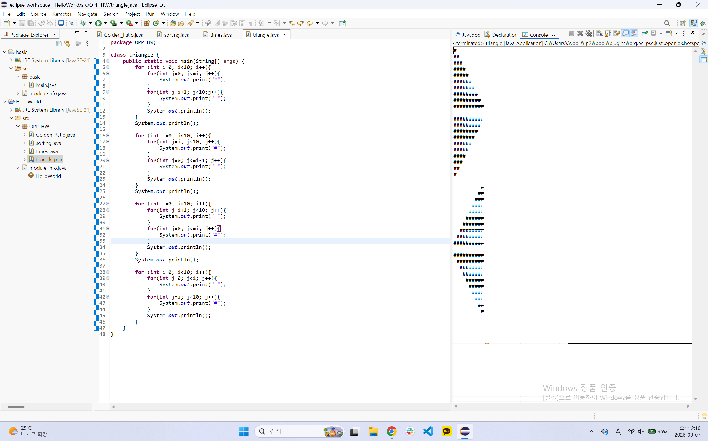


### Homework2
```java
class pibonacci {
    public static void main(String[] args) {
        int a=1, b=1, c;

        System.out.print("1 1 ");

        for(int i=0; i<18; i++){
            c = a+b;
            System.out.print(c+" ");
            a=b;
            b=c;
        }
    }
}
```

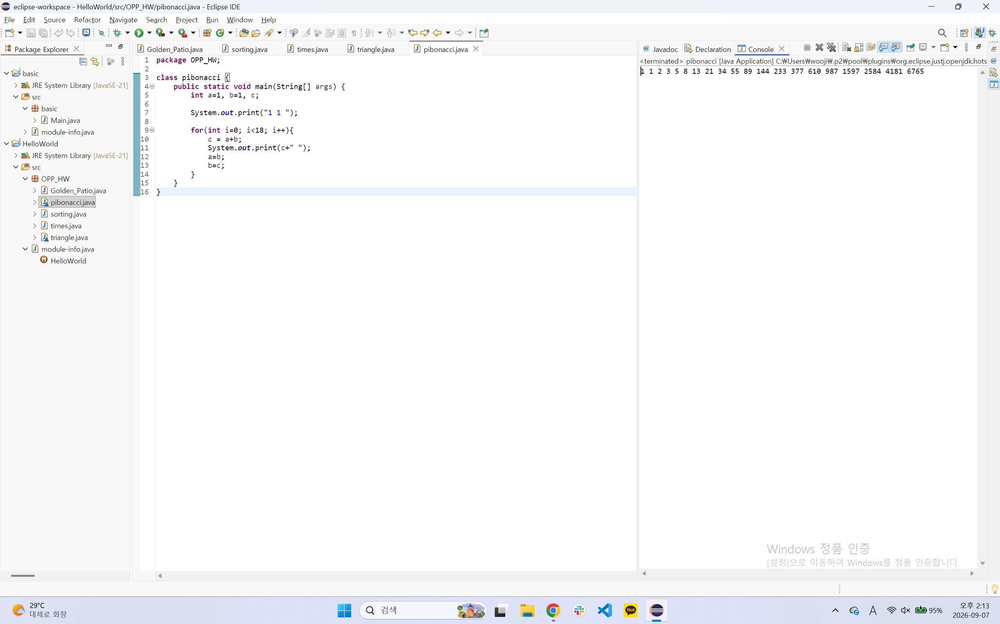


### Homework3
```java
public class Golden_Patio {
	public static void main(String[] args) {
		int a=1, b=1, c;
		double ratio;
		
		for(int i=0; i<20; i++) {
			c=a+b;
			ratio=(double)c/b;
			System.out.printf("%.12f\n", ratio);
			a=b;
			b=c;
		}
	}
}
```

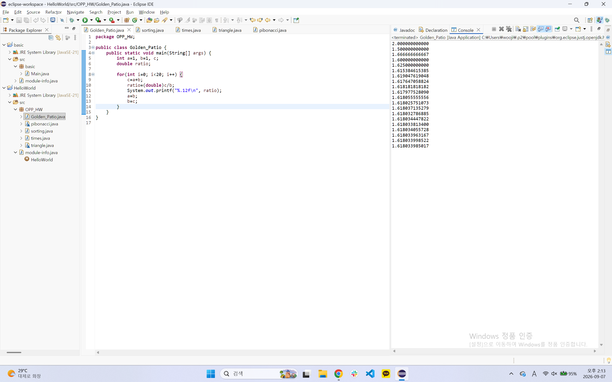


### Homwork4
```java
public class times {

	public static void main(String[] args) {
		for(int i=1; i<10; i++) {
			for(int j=1; j<10; j++) {
				System.out.print(j + "*" + i + "=" + j*i + " ");
			}
			System.out.println();
		}
	}

}
```

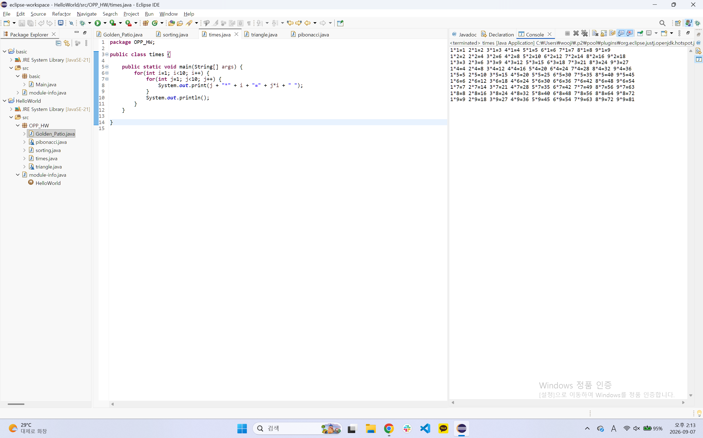
</details>

<details>
<summary>Week2 Homework</summary>
	
### Homework5
```java
public class Pie {

	public static void main(String[] args) {
		// 변수 선언 
		double root_twelve = Math.sqrt(12);
		double pie;
		double a = 1.0;
		
		// 수식 영역
		for (int i = 0; i<25; i++) {
			
			double c = Math.pow(3, i + 1);
			
			if (i % 2 == 0) {
				a = a - 1.0/((3 + 2 * i) * c);
			} else {
				a = a + 1.0/((3 + 2 * i) * c);
			}
			
			pie = root_twelve*a;
			
			System.out.printf("%.12f\n", pie);
		}
	}	
}
```

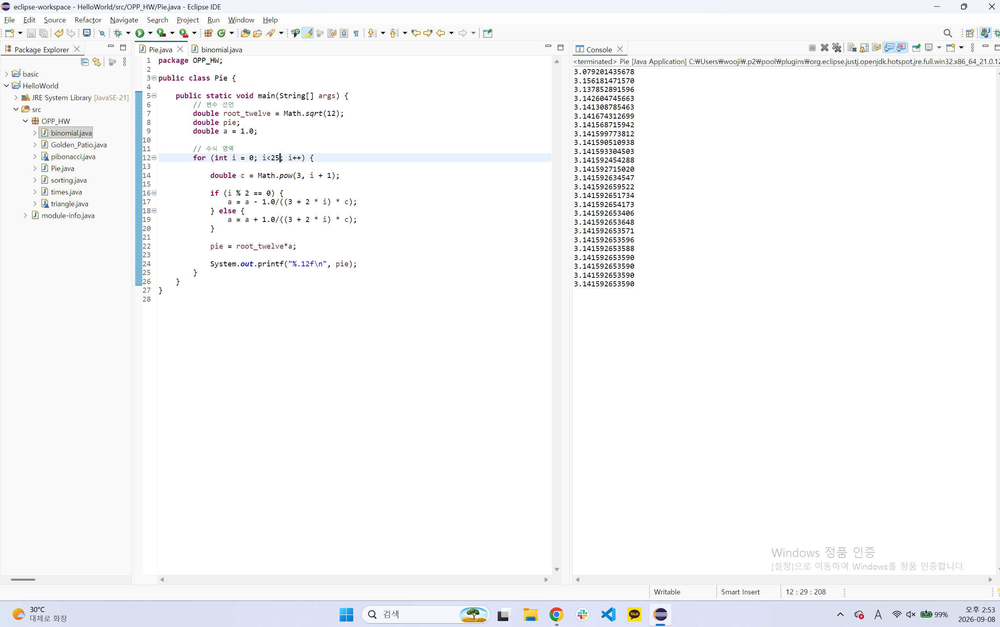


### Homework6
```java
public class binomial {

	public static void main(String[] args) {
		// 배열 선언
		int[][] binomial = new int[10][10];
		binomial[0][0] = 1;
		
		// 1행 출력
		for (int i = 0; i < 10; i++) {
			System.out.printf("%3d ",binomial[0][i]);
		}
		System.out.println();
		
		// 2행 이후 출력
		for (int i = 0; i<9; i++) {
			for (int j = 0; j < 10; j++) {
				if (j == 0) {
					binomial[i+1][j] = binomial[i][j];
				} else {
					binomial[i+1][j] = binomial[i][j] + binomial[i][j-1];
				}
				System.out.printf("%3d ", binomial[i+1][j]);
			}
			
			System.out.println();
		}
	}

}

```

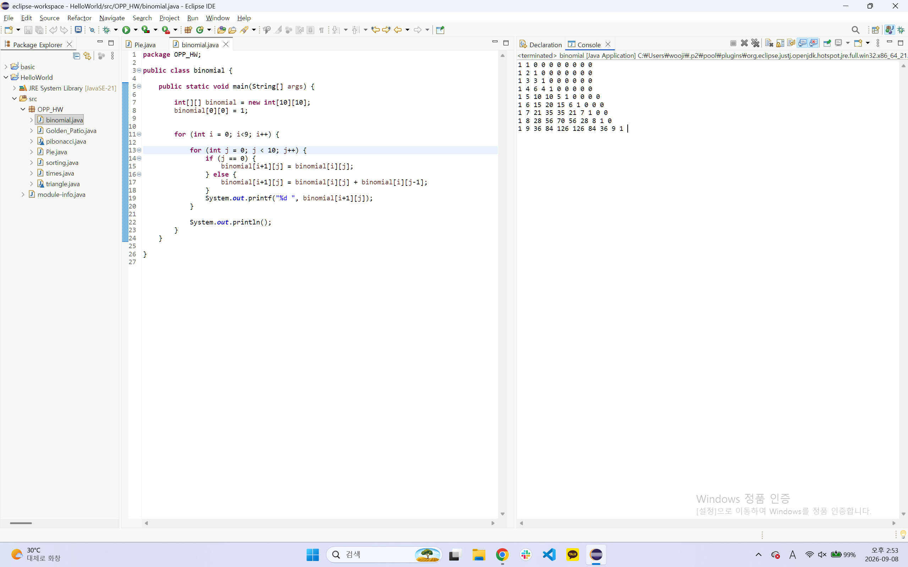


### Homework7
```java
public class sort {

	public static void main(String[] args) {
		int[] sort = new int[20];
		int change;
		
		// 배열 생성
		for (int i = 0; i < 20; i++) {
			sort[i] = (int)(Math.random()*100);
		}
		
		// 정렬 전 배열 출력
		for (int i = 0; i < 20; i++) {
			System.out.printf("%d ", sort[i]);
		}
		
		// 정렬(좌우 비교 후, 왼쪽이 크면 위치 교환. 그리고 다시 처음으로 돌아가기)
		for (int i = 1; i < 20; i++) {
			if (sort[i-1] > sort[i]) {
				change = sort[i-1];
				sort[i-1] = sort[i];
				sort[i] = change;
				
				i = 0;
			}
		}
		System.out.println();
		
		// 정렬 후 배열 출력
		for (int i = 0; i < 20; i++) {
			System.out.printf("%d ", sort[i]);
		}
		
	}

}
```

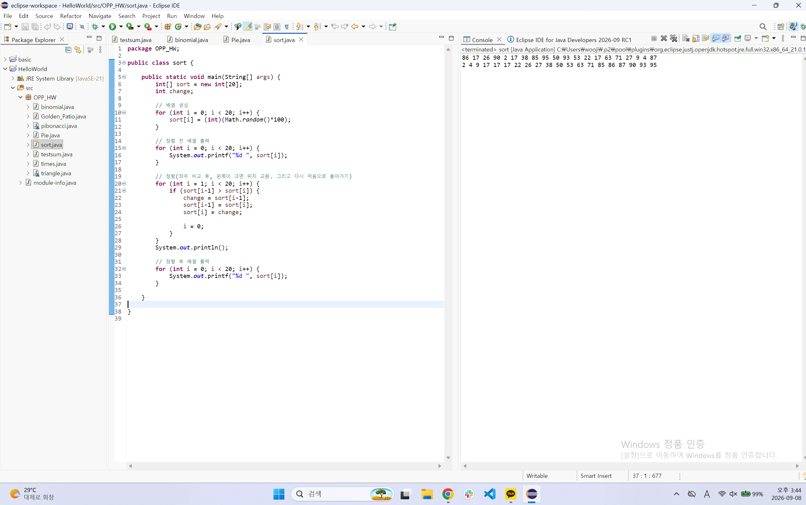


### Homework8
```java
public class testsum {

	public static void main(String[] args) {
		// 배열과 변수 선언
		int student = (int)(Math.random()*100);
		int[][] testsum = new int[student][4];
		
		// 학생 수만큼 성적 입력 반복
		for (int i = 0; i < student; i++) {
			int sum = 0;
			System.out.printf("%3d번째 학생 : ", (i+1));
			for (int j = 0; j < 4; j++) {
				testsum[i][j] = (int)(Math.random()*100);
				System.out.printf("%3d ", testsum[i][j]);
				sum = sum + testsum[i][j];
			}
			System.out.printf("|| 합계:%d점\n", sum);
		}
		
	}

}
```

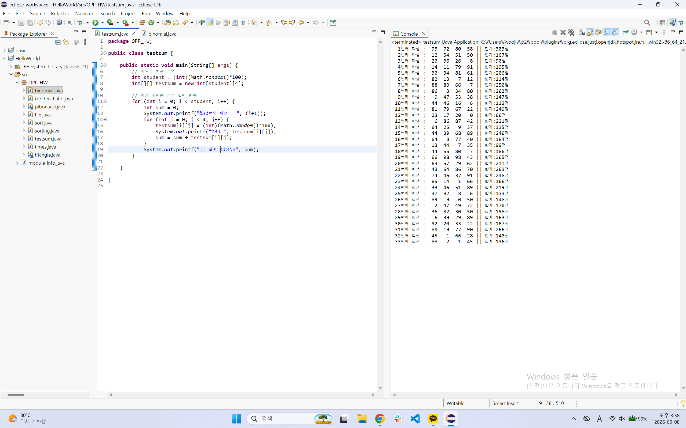

</details>


<details>
<summary>Week3 Homework</summary>
	
### Homework10

```java
import java.util.Random;
import java.util.Scanner;


public class Dosu {

	public static void main(String[] args) {
		// 스캐너 선언
		Scanner sc = new Scanner(System.in);
		
		// 변수 선언
		int array_count, max_value, bin_size, display_scale;
		int index, last_max;

		
		// 입력 부분
		System.out.print("랜덤 생성할 표본 수 : ");
		array_count = sc.nextInt();
		
		System.out.print("\n랜덤 생성할 표본의 최댓값 : ");
		max_value = sc.nextInt();
		
		System.out.print("\n구분할 범위 : ");
		bin_size = sc.nextInt();
		
		System.out.print("\n#의 대응비 : ");
		display_scale = sc.nextInt();
		
		while(display_scale <= 0) { // display_scale == 0 인경우 오류발생하므로 방지하기 위한 구문
			System.out.print("\n#의 대응비 : ");
			display_scale = sc.nextInt();
		}
		
		// 배열 선언
		int[] array_data = new int[array_count];
		int[] array_Dosu = new int[(max_value + bin_size - 1)/bin_size]; // (최댓값+범위값-1)/범위값 = 필요한 배열의 크기를 구하기 위한 올림나눗셈
		
		// 입력이 필요한 변수 추가선언
		int range = ( max_value / bin_size - 1 )/ bin_size; //
		
		// 생성된 변수의 구간을 계산, 구간에 추가시키는 반복분
		for (int i=0; i<array_data.length; i++) {
			array_data[i] = (int)(Math.random()*max_value); // 0~100까지의 랜덤변수 생성
			index = array_data[i] / bin_size; // 생성값/범위값의 정수 부분만 따져서 인덱스 결정
			array_Dosu[index]++; // 해당하는 인덱스 +1
		}
		
		
		for (int i = 0; i < (max_value + bin_size - 1)/ bin_size; i++) {
			if (i == ( (max_value + bin_size - 1) / bin_size) - 1 ){
				last_max = max_value;
			} else {
				last_max = bin_size * (i+1) -1;
			}
			System.out.printf("%2d ~ %-10d", 0 + bin_size * i, last_max); // 올림나눗셈으로 범위를 지정시킬 수 있도록 함.
			for (int j = 0; j < array_Dosu[i] / display_scale; j++) { // 대응비에 따라 # 갯수 변경
				System.out.print("#");
			}
			System.out.println();
		}
	}

}
```
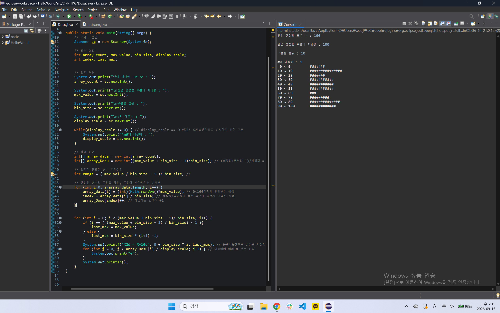
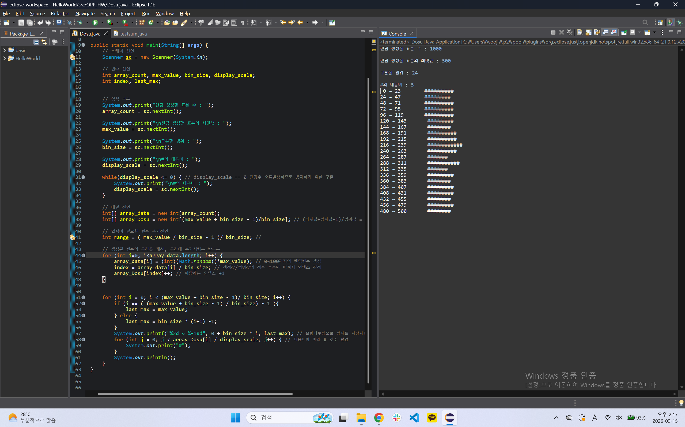


### Homwork 11
```java
import java.util.Scanner;
import java.util.Random;

public class mean {

	public static void main(String[] args) {
		// 스캐너 선언
		Scanner sc = new Scanner(System.in);
		
		
		// 변수 선언
		int array_count, change;
		double ari, geo, har, center;
		
		int value_count = 0;
		int geo_total = 1;
		double log_total = 0, har_total = 0, ari_total = 0;
		
		// 사용자 입력
		System.out.print("랜덤 생성할 변수 수 : ");
		array_count = sc.nextInt();
		while(array_count <= 0) {
			System.out.print("랜덤 생성할 변수 수 : ");
			array_count = sc.nextInt();
		}
		
		
		// 추가 변수 선언
		int[] array_data = new int[array_count];
		
		
		// 배열 랜덤값 생성
		for(int i = 0; i < array_count + 0; i++) {
			array_data[i] = (int)(Math.random()*100);
			System.out.printf("%3d ", array_data[i]);
			if( ( i + 1 ) % 25 == 0) {
				System.out.println();
			}
		}
		System.out.println();
		
		
		// 산술평균 반복문
		for(int i = 0; i < array_count; i++) {
			ari_total = ari_total + array_data[i];
		}
		ari = ari_total / array_data.length;
		
		System.out.printf("산술 평균 : %f\n", ari);
		
		
		// 기하평균 반복문
		for(int i = 0; i < array_count; i++) {
			if(array_data[i] != 0) {
				log_total += Math.log(array_data[i]);
				value_count += 1;
			}
		}
		geo = Math.exp(log_total/value_count);
		
		System.out.printf("기하 평균 : %f\n", geo);
		
		
		// 조화평균
		value_count = 0; // 사용한 변수 초기화
		for(int i = 0; i < array_count; i++) {
			if(array_data[i] != 0) {
				har_total = har_total + (1.0 / array_data[i]);
				value_count += 1;
			}
		}
		har = value_count / har_total;
		System.out.printf("조화 평균 : %f\n", har);
		
		
		// 중간값
		// 정렬 실시
		for (int i = 1; i < array_count; i++) {
			if (array_data[i-1] > array_data[i]) {
				change = array_data[i-1];
				array_data[i-1] = array_data[i];
				array_data[i] = change;
				
				i = 0;
			}
		}
		
		if(array_data.length % 2 == 0) {
			center = (array_data[array_data.length / 2 - 1] + array_data[(array_data.length / 2)]) / 2.0;
		} else {
			center = array_data[array_data.length / 2];
		}
		
		System.out.printf("종간값 : %f", center);
	}
}
```


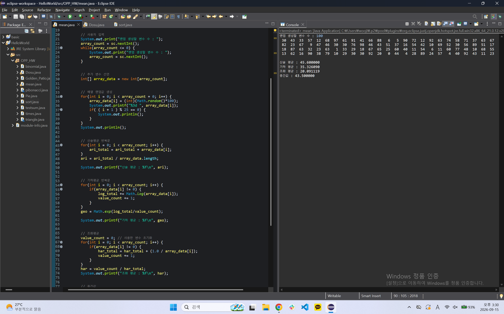

</details>


<details>
<summary>Week4 Homework</summary>

## Homework 13	
```java
import java.util.Scanner;

public class Calcul {
	public static void main(String[] args) {
		// 변수 선언
		int i = 1;
		int reverse = 3;
		double result = 0;
		
		// 스캐너 선언
		Scanner sc = new Scanner(System.in);
		
		// 계산식 입력 받기
		String inputString = sc.nextLine();
		String[] inputArray = inputString.split(" ");
		
		for (String a : inputArray) {
			System.out.println(a);
		}
		
		if (reverse < inputArray.length) {
		i = ((inputArray[1].equals("+") || inputArray[1].equals("-")) && (inputArray[3].equals("#") || (inputArray[3].equals("/")))) ? 3 : 1;
		}
		
		switch(inputArray[i]) {
		case "+" -> result = F_plus(Double.parseDouble(inputArray[i - 1]), Double.parseDouble(inputArray[i + 1]));
		case "-" -> result = F_minus(Double.parseDouble(inputArray[i - 1]), Double.parseDouble(inputArray[i + 1]));
		case "#" -> result = F_multi(Double.parseDouble(inputArray[i - 1]), Double.parseDouble(inputArray[i + 1]));
		case "/" -> result = F_divi(Double.parseDouble(inputArray[i - 1]), Double.parseDouble(inputArray[i + 1]));
		}
		
		if (reverse < inputArray.length) {
		if (i == 3) {
			i = 1;
			switch(inputArray[i]) {
			case "+" -> result = F_plus(Double.parseDouble(inputArray[i - 1]), result);
			case "-" -> result = F_minus(Double.parseDouble(inputArray[i - 1]), result);
			case "#" -> result = F_multi(Double.parseDouble(inputArray[i - 1]), result);
			case "/" -> result = F_divi(Double.parseDouble(inputArray[i - 1]), result);
			}
		} else {
			i = 3;
			switch(inputArray[i]) {
			case "+" -> result = F_plus(result, Double.parseDouble(inputArray[i + 1]));
			case "-" -> result = F_minus(result, Double.parseDouble(inputArray[i + 1]));
			case "#" -> result = F_multi(result, Double.parseDouble(inputArray[i + 1]));
			case "/" -> result = F_divi(result, Double.parseDouble(inputArray[i + 1]));
			}
		}
		}
	}
	
	public static double F_plus(double a, double b) {
		double out;
		out = a + b;
		
		System.out.printf("%f\n", out);
		return out;
	}
	
	public static double F_minus(double a, double b) {
		double out;
		out = a - b;
		
		System.out.printf("%f\n", out);
		return out;
	}
		
	public static double F_multi(double a, double b) {
		double out;
		out = a * b;
		
		System.out.printf("%f\n", out);
		return out;
	}
	
	public static double F_divi(double a, double b) {
		double out;
		out = a / b;
		
		System.out.printf("%f\n", out);
		return out;
	}
}
```
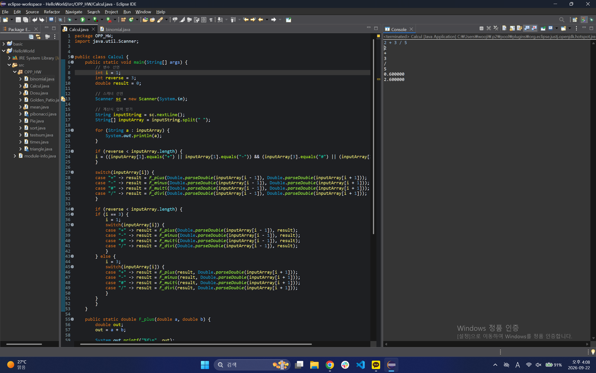


</details>


<details>
<summary>Week5 Homework</summary>

## Homework14
```java
package OPP_HW;

import java.util.random.*;


class Numbers {
	int num[];
	
	Numbers(int num[]) {
		this.num = num;
	}
	
	
	double getTotal() {
		double sum = 0;
		for (int i = 0; i < num.length; i++) {
			sum += num[i];
		}
		return sum;
	}
	
	
	// 산술 평균
	double getArithmaticMean() {
		return getTotal()/num.length;
	}
	
	
	// 기하 평균
	double getGeometricMean() {
		int array_count = num.length, value_count = 0;
		double log_total = 0;
		
		for(int i = 0; i < array_count; i++) {
			if(num[i] != 0) {
				log_total += Math.log(num[i]);
				value_count += 1;
			}
		}
		return Math.exp(log_total/value_count);
	}
	
	
	// 조화 평균
	double getHarmonicMean() {
		double har_total = 0;
		int array_count = num.length, value_count  = 0;
		
		for(int i = 0; i < array_count; i++) {
			if(num[i] != 0) {
				har_total = har_total + (1.0 / num[i]);
				value_count += 1;
			}
		}
		return value_count / har_total;
	}
	
	
	// 중간값
	double getCenter() {
		int array_count = num.length, change = 0;
		double center = 0;
		
		for (int i = 1; i < array_count; i++) {
			if (num[i-1] > num[i]) {
				change = num[i-1];
				num[i-1] = num[i];
				num[i] = change;
				
				i = 0;
			}
		} 
		if(num.length % 2 == 0) {
			center = (num[num.length / 2 - 1] + num[(num.length / 2)]) / 2.0;
		} else {
			center = num[num.length / 2];
		}
		return center;
	}
	
	
	// 히스토그램 생성을 위한 정렬
	void sorting() {
		System.out.printf("\nsorting...\n");
		
		int change = 0;
		
		for (int i = 1; i < num.length; i++) {
			if (num[i-1] > num[i]) {
				change = num[i-1];
				num[i-1] = num[i];
				num[i] = change;
				
				i = 0;
			}
		}
		
		System.out.printf("100 : ");
		
		for (int i = 0; i < num.length; i++) {
			System.out.printf("%d ", num[i]);
		}
		
		System.out.printf("\n\n");
	}
	
	
	// 히스토그램 생성 객체
	void drawHistogram(int start, int end, int binCount, int scale) {
		// 배열 선언
		int[] array_data = new int[end];
		int[] array_Dosu = new int[(end + binCount - 1)/binCount]; // (최댓값+범위값-1)/범위값 = 필요한 배열의 크기를 구하기 위한 올림나눗셈
		
		// 변수 선언
		int range = ( end / binCount - 1 )/ binCount, index = 0, lastMax = 0; //
		
		// 생성된 변수의 구간을 계산, 구간에 추가시키는 반복분
		for (int i=0; i<array_data.length; i++) {
			array_data[i] = (int)(Math.random()*end); // 0~100까지의 랜덤변수 생성
			index = array_data[i] / binCount; // 생성값/범위값의 정수 부분만 따져서 인덱스 결정
			array_Dosu[index]++; // 해당하는 인덱스 +1
		}
		
		
		for (int i = 0; i < (end + binCount - 1)/ binCount; i++) {
			if (i == ( (end + binCount - 1) / binCount) - 1 ){
				lastMax = end;
			} else {
				lastMax = binCount * (i+1) -1;
			}
			System.out.printf("%8d ~ %-10d", 0 + binCount * i, lastMax); // 올림나눗셈으로 범위를 지정시킬 수 있도록 함.
			for (int j = 0; j < array_Dosu[i] / scale; j++) { // 대응비에 따라 # 갯수 변경
				System.out.print("#");
			}
			System.out.println();
		}
	}
	
	
	//
	void display() {
		System.out.printf("%3d :", num.length);		
		
		for(int i=0; i<num.length; i++) 
			System.out.printf("%3d ", num[i]);
			System.out.println();

	}
	
}

public class Dosu_complite {
	public static void main(String[] args) {
		// 변수와 배열 선언
		int size = 100;
		int data[] = new int [size];
		
		
		// data[]에 랜덤값 100개 생성
		for (int i = 0; i < size; i++) {
			data[i] = (int)(Math.random()*100);
		}
		
		// 클래스에서 사용할 매개변수 정의
		Numbers obj = new Numbers(data);
		
		
		// 실제 실행되는 객체들
		obj.display();
		
		obj.sorting();
		
		System.out.printf("Arithmetic Mean : %5.2f\n\n", obj.getArithmaticMean()); 
	
		System.out.printf("Geometric Mean : %5.2f\n\n", obj.getGeometricMean());
		
		System.out.printf("Harmonic Mean : %5.2f\n\n", obj.getHarmonicMean());
		
		System.out.printf("Center Value : %5.2f\n\n", obj.getCenter());
		
		System.out.println();
		
		obj.drawHistogram(0,100,10, 1);

		
	}
}

```

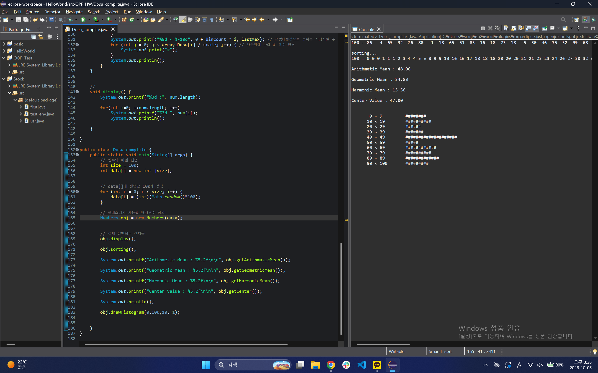

</details>


<details>
<summary>Week6 Homework</summary>
	
### Homework15
C2048.java
```java
import java.util.ArrayList;

public class C2048 {
	int value[][] = new int[4][4];
	boolean moved = false;   // 이번 이동에서 판이 실제로 바뀌었는지

	// 애니메이션용 기록
	ArrayList<int[]> moves = new ArrayList<>();   // {시작행, 시작열, 도착행, 도착열, 값}
	int spawnR = -1, spawnC = -1;                 // 이번에 새로 생긴 타일 위치
	int[] destOf = new int[4];                    // slide()에서 각 칸의 도착 인덱스 (-1: 빈 칸)

	C2048() {
		init();
	}


	void init() {
		int i = (int) (Math.random()*4);
		int j = (int) (Math.random()*4);
		int k = ((int)(Math.random()*2)+1)*2;
		value[i][j] = k;
		i = (int) (Math.random()*4);
		j = (int) (Math.random()*4);
		k = ((int)(Math.random()*2)+1)*2;
		value[i][j] = k;

	}


	// 이동 후 호출: 판이 바뀌었을 때만 빈 칸 중 한 곳에 2 또는 4 생성
	void update() {
		if (!moved) return;

		int empty = 0;
		for (int i = 0; i < 4; i++)
			for (int j = 0; j < 4; j++)
				if (value[i][j] == 0) empty++;
		if (empty == 0) return;

		int target = (int) (Math.random() * empty);
		int k = ((int) (Math.random()*2)+1)*2;
		for (int i = 0; i < 4; i++) {
			for (int j = 0; j < 4; j++) {
				if (value[i][j] == 0) {
					if (target == 0) {
						value[i][j] = k;
						spawnR = i;      // 새 타일 위치 기록
						spawnC = j;
						return;
					}
					target--;
				}
			}
		}
	}


	// 한 줄을 index 0 방향으로 밀면서 합침. destOf[n]에 n번 칸 타일의 도착 위치를 기록
	int[] slide(int[] line) {
		int[] result = new int[4];
		int r = 0;
		boolean canMerge = false;   // 직전 타일이 아직 합쳐지지 않았는지

		for (int n = 0; n < 4; n++) {
			destOf[n] = -1;
			if (line[n] == 0) continue;

			if (r > 0 && canMerge && result[r - 1] == line[n]) {
				result[r - 1] *= 2;       // 직전 타일과 합치기
				destOf[n] = r - 1;
				canMerge = false;         // 한 번 합쳐진 칸은 다시 합치지 않음
			} else {
				result[r] = line[n];
				destOf[n] = r;
				r++;
				canMerge = true;
			}
		}
		return result;
	}


	void left() {
		moved = false; moves.clear(); spawnR = -1; spawnC = -1;
		for (int i = 0; i < 4; i++) {
			int[] line = new int[4];
			for (int j = 0; j < 4; j++) line[j] = value[i][j];
			int[] res = slide(line);
			for (int j = 0; j < 4; j++) {
				if (line[j] != 0) moves.add(new int[]{i, j, i, destOf[j], line[j]});
				if (value[i][j] != res[j]) moved = true;
				value[i][j] = res[j];
			}
		}

		update();
		display();
	}


	void right() {
		moved = false; moves.clear(); spawnR = -1; spawnC = -1;
		for (int i = 0; i < 4; i++) {
			int[] line = new int[4];
			for (int j = 0; j < 4; j++) line[j] = value[i][3 - j];
			int[] res = slide(line);
			for (int j = 0; j < 4; j++) {
				if (line[j] != 0) moves.add(new int[]{i, 3 - j, i, 3 - destOf[j], line[j]});
				if (value[i][3 - j] != res[j]) moved = true;
				value[i][3 - j] = res[j];
			}
		}

		update();
		display();
	}


	void up() {
		moved = false; moves.clear(); spawnR = -1; spawnC = -1;
		for (int j = 0; j < 4; j++) {
			int[] line = new int[4];
			for (int i = 0; i < 4; i++) line[i] = value[i][j];
			int[] res = slide(line);
			for (int i = 0; i < 4; i++) {
				if (line[i] != 0) moves.add(new int[]{i, j, destOf[i], j, line[i]});
				if (value[i][j] != res[i]) moved = true;
				value[i][j] = res[i];
			}
		}

		update();
		display();
	}


	void down() {
		moved = false; moves.clear(); spawnR = -1; spawnC = -1;
		for (int j = 0; j < 4; j++) {
			int[] line = new int[4];
			for (int i = 0; i < 4; i++) line[i] = value[3 - i][j];
			int[] res = slide(line);
			for (int i = 0; i < 4; i++) {
				if (line[i] != 0) moves.add(new int[]{3 - i, j, 3 - destOf[i], j, line[i]});
				if (value[3 - i][j] != res[i]) moved = true;
				value[3 - i][j] = res[i];
			}
		}

		update();
		display();
	}


	void display() {
		for(int i=0; i<4; i++) {
			for(int j=0; j<4; j++)
			System.out.printf("%3d ", value[i][j]);
			System.out.println();
		}

		System.out.println();
	}


	boolean isCleared() {
		for (int i = 0; i < 4; i++)
			for (int j = 0; j < 4; j++)
				if (value[i][j] >= 2048) return true;
		return false;
	}


	boolean isGameOver() {
		for (int i = 0; i < 4; i++) {
			for (int j = 0; j < 4; j++) {
				if (value[i][j] == 0) return false;
				if (j + 1 < 4 && value[i][j] == value[i][j + 1]) return false;
				if (i + 1 < 4 && value[i][j] == value[i + 1][j]) return false;
			}
		}
		return true;
	}
}
```

C2048Player.java
```java
import javax.swing.*;
import java.awt.*;
import java.awt.event.KeyAdapter;
import java.awt.event.KeyEvent;
import java.util.ArrayList;
import java.util.List;

public class C2048Player extends JFrame {

	static final int TILE = 100;
	static final int GAP = 10;
	static final int SLIDE_MS = 120;   // 슬라이드 시간
	static final int POP_MS = 100;     // 새 타일 등장 / 합쳐짐 효과 시간

	C2048 obj = new C2048();
	boolean finished = false;
	String message = null;
	BoardPanel board = new BoardPanel();

	// 애니메이션 상태
	Timer timer;
	boolean animating = false;
	int phase = 0;                 // 0: 슬라이드, 1: 팝 효과
	double progress = 0;           // 현재 단계의 진행도 (0~1)
	long startTime;
	List<int[]> moves = new ArrayList<>();
	boolean[][] mergedCell = new boolean[4][4];
	int spawnR = -1, spawnC = -1;

	C2048Player() {
		setTitle("2048");
		setDefaultCloseOperation(EXIT_ON_CLOSE);
		setResizable(false);

		JPanel top = new JPanel(new BorderLayout());
		top.setBackground(new Color(0xFAF8EF));
		top.setBorder(BorderFactory.createEmptyBorder(10, 15, 5, 15));

		JLabel title = new JLabel("2048");
		title.setFont(new Font("맑은 고딕", Font.BOLD, 36));
		title.setForeground(new Color(0x776E65));
		top.add(title, BorderLayout.WEST);

		JButton restartBtn = new JButton("새 게임");
		restartBtn.setFocusable(false);
		restartBtn.addActionListener(e -> restart());
		top.add(restartBtn, BorderLayout.EAST);

		JLabel hint = new JLabel("방향키로 타일을 움직이세요  (R: 재시작, ESC: 종료)", SwingConstants.CENTER);
		hint.setFont(new Font("맑은 고딕", Font.PLAIN, 13));
		hint.setForeground(new Color(0x776E65));
		hint.setBorder(BorderFactory.createEmptyBorder(0, 0, 8, 0));

		JPanel north = new JPanel(new BorderLayout());
		north.setBackground(new Color(0xFAF8EF));
		north.add(top, BorderLayout.NORTH);
		north.add(hint, BorderLayout.SOUTH);

		add(north, BorderLayout.NORTH);
		add(board, BorderLayout.CENTER);

		board.setFocusable(true);
		board.addKeyListener(new KeyAdapter() {
			@Override
			public void keyPressed(KeyEvent e) {
				int code = e.getKeyCode();

				if (code == KeyEvent.VK_ESCAPE) System.exit(0);
				if (code == KeyEvent.VK_R) { restart(); return; }
				if (finished || animating) return;   // 애니메이션 중에는 입력 무시

				switch (code) {
					case KeyEvent.VK_LEFT:  obj.left();  break;
					case KeyEvent.VK_RIGHT: obj.right(); break;
					case KeyEvent.VK_UP:    obj.up();    break;
					case KeyEvent.VK_DOWN:  obj.down();  break;
					default: return;
				}

				if (!obj.moved) return;   // 변화가 없으면 애니메이션 없음
				startAnimation();
			}
		});

		pack();
		setLocationRelativeTo(null);
	}

	// C2048이 기록한 이동 정보를 복사하고 타이머 시작
	void startAnimation() {
		moves = new ArrayList<>(obj.moves);
		spawnR = obj.spawnR;
		spawnC = obj.spawnC;

		// 같은 칸에 두 타일이 도착하면 합쳐진 칸
		int[][] count = new int[4][4];
		for (int[] m : moves) count[m[2]][m[3]]++;
		for (int i = 0; i < 4; i++)
			for (int j = 0; j < 4; j++)
				mergedCell[i][j] = count[i][j] >= 2;

		animating = true;
		phase = 0;
		progress = 0;
		startTime = System.currentTimeMillis();

		timer = new Timer(15, e -> tick());
		timer.start();
	}

	void tick() {
		long elapsed = System.currentTimeMillis() - startTime;

		if (phase == 0) {
			double t = Math.min(1.0, elapsed / (double) SLIDE_MS);
			progress = 1 - Math.pow(1 - t, 3);   // ease-out: 빠르게 출발해서 천천히 멈춤
			if (t >= 1.0) {
				phase = 1;
				startTime = System.currentTimeMillis();
			}
		} else {
			double t = Math.min(1.0, elapsed / (double) POP_MS);
			progress = t;
			if (t >= 1.0) {
				timer.stop();
				animating = false;
				checkState();   // 애니메이션이 끝난 뒤 클리어/게임 오버 판정
			}
		}
		board.repaint();
	}

	void checkState() {
		if (obj.isCleared()) {
			finished = true;
			message = "CLEAR!\n2048 달성! (R: 새 게임)";
		} else if (obj.isGameOver()) {
			finished = true;
			message = "GAME OVER\n(R: 새 게임)";
		}
	}

	void restart() {
		if (timer != null) timer.stop();
		animating = false;
		obj = new C2048();
		finished = false;
		message = null;
		board.requestFocusInWindow();
		board.repaint();
	}

	static Color tileColor(int v) {
		switch (v) {
			case 0:    return new Color(0xCDC1B4);
			case 2:    return new Color(0xEEE4DA);
			case 4:    return new Color(0xEDE0C8);
			case 8:    return new Color(0xF2B179);
			case 16:   return new Color(0xF59563);
			case 32:   return new Color(0xF67C5F);
			case 64:   return new Color(0xF65E3B);
			case 128:  return new Color(0xEDCF72);
			case 256:  return new Color(0xEDCC61);
			case 512:  return new Color(0xEDC850);
			case 1024: return new Color(0xEDC53F);
			case 2048: return new Color(0xEDC22E);
			default:   return new Color(0x3C3A32);
		}
	}

	static double cellPos(double idx) {
		return GAP + idx * (TILE + GAP);
	}

	class BoardPanel extends JPanel {
		BoardPanel() {
			int size = TILE * 4 + GAP * 5;
			setPreferredSize(new Dimension(size, size));
			setBackground(new Color(0xFAF8EF));
		}

		// 타일 하나 그리기 (x, y는 칸의 좌상단, scale로 크기 조절)
		void drawTile(Graphics2D g, int v, double x, double y, double scale) {
			double size = TILE * scale;
			if (size < 2) return;
			double off = (TILE - size) / 2;

			g.setColor(tileColor(v));
			g.fillRoundRect((int) (x + off), (int) (y + off), (int) size, (int) size, 10, 10);

			String s = String.valueOf(v);
			int base = s.length() <= 2 ? 40 : (s.length() == 3 ? 34 : 28);
			g.setFont(new Font("맑은 고딕", Font.BOLD, Math.max(1, (int) (base * scale))));
			g.setColor(v <= 4 ? new Color(0x776E65) : Color.WHITE);

			FontMetrics fm = g.getFontMetrics();
			int tx = (int) (x + (TILE - fm.stringWidth(s)) / 2.0);
			int ty = (int) (y + (TILE - fm.getHeight()) / 2.0 + fm.getAscent());
			g.drawString(s, tx, ty);
		}

		@Override
		protected void paintComponent(Graphics g0) {
			super.paintComponent(g0);
			Graphics2D g = (Graphics2D) g0;
			g.setRenderingHint(RenderingHints.KEY_ANTIALIASING, RenderingHints.VALUE_ANTIALIAS_ON);
			g.setRenderingHint(RenderingHints.KEY_TEXT_ANTIALIASING, RenderingHints.VALUE_TEXT_ANTIALIAS_ON);

			int size = TILE * 4 + GAP * 5;

			g.setColor(new Color(0xBBADA0));
			g.fillRoundRect(0, 0, size, size, 15, 15);

			// 빈 칸 배경은 항상 그림
			g.setColor(tileColor(0));
			for (int i = 0; i < 4; i++)
				for (int j = 0; j < 4; j++)
					g.fillRoundRect((int) cellPos(j), (int) cellPos(i), TILE, TILE, 10, 10);

			if (animating && phase == 0) {
				// 슬라이드 단계: 이동 전 값으로 시작 칸 → 도착 칸 보간
				for (int[] m : moves) {
					double r = m[0] + (m[2] - m[0]) * progress;
					double c = m[1] + (m[3] - m[1]) * progress;
					drawTile(g, m[4], cellPos(c), cellPos(r), 1.0);
				}
			} else {
				// 팝 단계 또는 정지 상태: 최종 판을 그림
				for (int i = 0; i < 4; i++) {
					for (int j = 0; j < 4; j++) {
						int v = obj.value[i][j];
						if (v == 0) continue;

						double scale = 1.0;
						if (animating) {
							if (i == spawnR && j == spawnC) scale = progress;                       // 새 타일: 0 → 1
							else if (mergedCell[i][j]) scale = 1 + 0.2 * Math.sin(Math.PI * progress); // 합쳐진 타일: 살짝 커졌다 복귀
						}
						drawTile(g, v, cellPos(j), cellPos(i), scale);
					}
				}
			}

			if (message != null) {
				g.setColor(new Color(255, 255, 255, 170));
				g.fillRoundRect(0, 0, size, size, 15, 15);

				String[] lines = message.split("\n");
				g.setColor(new Color(0x776E65));
				g.setFont(new Font("맑은 고딕", Font.BOLD, 44));
				FontMetrics fm = g.getFontMetrics();
				g.drawString(lines[0], (size - fm.stringWidth(lines[0])) / 2, size / 2 - 5);

				if (lines.length > 1) {
					g.setFont(new Font("맑은 고딕", Font.PLAIN, 20));
					fm = g.getFontMetrics();
					g.drawString(lines[1], (size - fm.stringWidth(lines[1])) / 2, size / 2 + 35);
				}
			}
		}
	}

	public static void main(String[] args) {
		SwingUtilities.invokeLater(() -> {
			C2048Player p = new C2048Player();
			p.setVisible(true);
			p.board.requestFocusInWindow();
		});
	}
}
```


